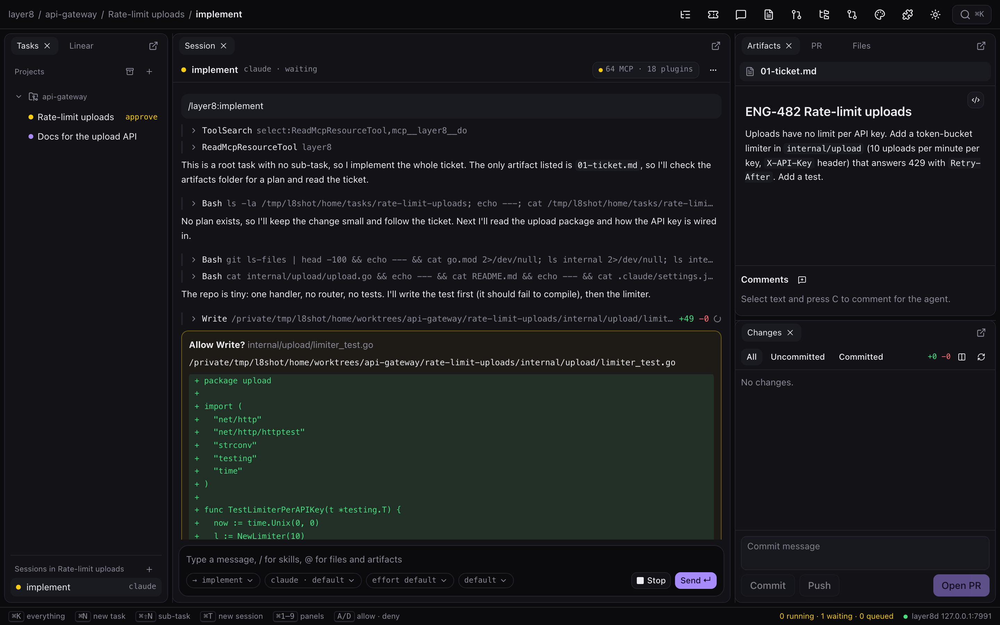
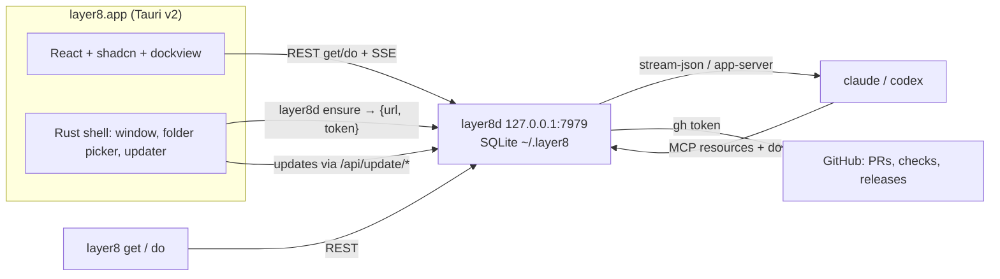

# layer8

A single-user macOS desktop home for agent work. Projects hold tasks, tasks hold sub-tasks (stacked branches, one worktree each) and Claude Code or Codex sessions, and every session in a task tree shares one artifacts folder. Workflows chain skills (research → plan → implement → describe PR) that drive the app themselves, and a session is two clicks from a reviewed diff and an open pull request.



Install it from the DMG: see [INSTALL.md](INSTALL.md).

## Architecture

A Go daemon (`layer8d`) owns all state and every agent process, and outlives the window as a launchd agent. The Tauri window, the `layer8` CLI, agents (over MCP) and UI plugins are all clients of one node tree.



## The node tree

Everything is a node with an address (`app`, `project:api-gateway`, `task:eng-482/pr2`, `here`). Reading a node returns its fields, children and the actions valid right now with a JSON Schema for their args. Every action is recorded in `actions_log` with who triggered it.

| Door | Read | Act |
|---|---|---|
| HTTP | `GET /api/node?addr=app&depth=1` | `POST /api/do` `{"ops":[{"target","action","args"}]}` |
| MCP `POST /mcp` | `resources/read layer8://project/api-gateway` | tool `do` |
| CLI | `layer8 get project:api-gateway [--json]` | `layer8 do app add-project path=/src/api-gateway` |
| Live | `GET /api/events` (SSE: `node`, `session`, `ui`, `toast`) | |

## Layout

| Path | Role |
|---|---|
| `cmd/layer8d` | `serve`, `ensure`, and the CLI (`get`, `do`); `bin/layer8` is a symlink |
| `internal/tree` | kinds, actions, `Get`/`Do`, `Render`, args validation |
| `internal/tasks`, `internal/gitx` | tasks and sub-tasks, worktrees, branches, artifacts |
| `internal/sessions`, `internal/harness/{claude,codex}` | sessions, approvals, transcripts, capability probe |
| `internal/workflows`, `plugin/` | workflows and the bundled layer8 Claude Code plugin (skills) |
| `internal/diff`, `internal/github`, `internal/comments` | diff, commit, push, pull requests and their status, comments to the agent |
| `internal/update` | the app's update feed, proxied from the private repo's latest release |
| `internal/server` | loopback/origin/token guard, HTTP API, SSE hub |
| `internal/mcp` | MCP streamable HTTP endpoint |
| `internal/projects` | `app` and `project` kinds |
| `internal/store` | SQLite + migrations |
| `internal/config` | `~/.layer8` (or `LAYER8_HOME`), `config.json`, token |
| `internal/ui` | `ui:layout`, `ui:theme`, `ui:plugins`: dock layout and presets, themes, JS plugins |
| `internal/daemon` | wiring, serve, launchd agent `dev.layer8.daemon`, restart onto a new binary when idle |
| `app/` | the Tauri window: `src/` React UI and panels, `src-tauri/` Rust shell |
| `e2e/` | the cut-over check against a real daemon and the real `claude` |

## Links

A task can point at something outside layer8, such as an issue in a tracker: `layer8 do task:eng-482 set-link url=https://… label=ENG-482` sets its `link` field (`{url, label}`), shown as a pill in the top bar; an empty `url` clears it. Integrations with trackers ship as plugins (see below), not in the core.

## Customise

- **Layout:** drag tabs to split or stack panels, or pop a group out into its own window. The layout is saved to `~/.layer8/ui.json` as it changes. ⌘K switches presets (Default, Focus, Review, Wide diff) and saves your own.
- **Themes:** the Theme panel edits the shadcn tokens with a live preview, switches dark, light or system, and sets an accent. A theme is a JSON file of token overrides, `{"shared": {...}, "dark": {...}, "light": {...}}`, saved in `~/.layer8/themes/`.
- **Plugins:** drop an ES module in `~/.layer8/plugins/<name>.js`, and it loads and hot-reloads in the window. It can register panels and ⌘K commands. `layer8 get ui:plugins` prints the SDK and each plugin's status. `examples/plugins/open-prs.js` lists the open PRs across tasks; `examples/plugins/linear.js` lists your Linear issues with your own API key and starts a task from one (copy it into `~/.layer8/plugins/`).
- **Keys:** ⌘K palette, ⌘N task, ⌘⇧N sub-task, ⌘T session, ⌘1–9 panels.

## Develop

```sh
make test     # go test ./...
make daemon   # bin/layer8d + bin/layer8
make dev      # run the daemon from source with LAYER8_HOME=./.dev-home
```

The UI runs in a browser against `make dev`: `cd app && npm i && npm run dev`, then open `http://localhost:5173/?url=http://127.0.0.1:7979&token=$(cat .dev-home/token)`. Without a reachable daemon it falls back to an in-memory mock. `npm run tauri dev` opens it in the Tauri window. App checks: `npm run typecheck && npm test` in `app/`.

CI runs only on pull requests, on Linux (`gofmt`, `go vet`, `go test`, app typecheck and tests). Everything macOS is built locally:

| Command | Does |
|---|---|
| `make app` | universal `layer8.app`, DMG and signed updater bundle in `app/src-tauri/target/universal-apple-darwin/release/bundle/`. Installs Rust targets if needed; ad-hoc signs unless `APPLE_SIGNING_IDENTITY` is set; Tauri notarizes when `APPLE_ID`/`APPLE_PASSWORD`/`APPLE_TEAM_ID` (or `APPLE_API_*`) are set |
| `make release VERSION=x.y.z` | `make app` at that version, writes `latest.json`, and publishes GitHub release `vx.y.z` with `gh release create`. Needs a clean tree pushed to origin |
| `make e2e` | the cut-over check: a temp repo, a real daemon on a free port, real `claude` (haiku), the `quick-fix` workflow on autopilot, open-pr against a fake GitHub and a local bare remote. About 40 s and a few cents |

The updater signing key lives in `~/.layer8-release/updater.key` (generated on first build, never committed); its public key is `plugins.updater.pubkey` in `app/src-tauri/tauri.conf.json`. Losing the key means installed apps can't verify new updates.

The app checks `http://127.0.0.1:7979/api/update/latest.json` with its daemon token. The daemon reads the latest release of `updateRepo` (default `crashPopeye/layer8`) with your `gh` token, rewrites the asset URLs in its `latest.json` to `/api/update/asset/<id>`, and streams only those assets. After an update the new app's `layer8d ensure` asks the old daemon to restart, which it does once no session is running.
