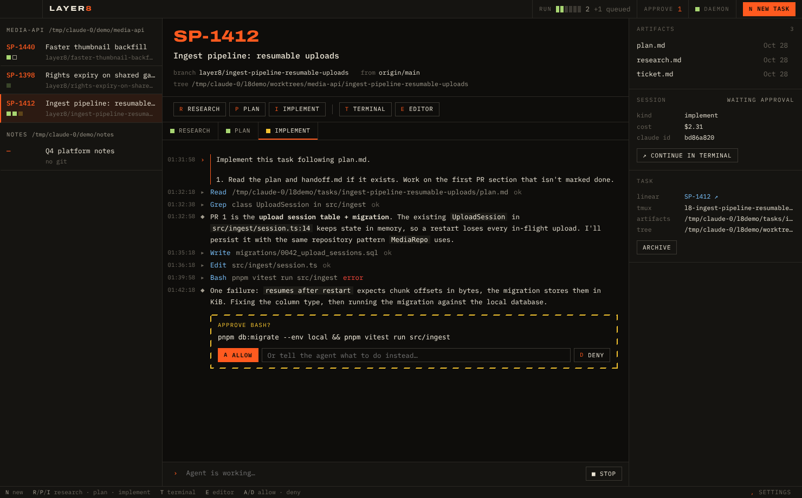

# layer8

A desktop workbench for running many long agent tasks in parallel. Each task
starts from a Linear ticket, gets its own git worktree and tmux session, and
moves through research → plan → implement in separate sessions, each with a
fresh context. Sessions hand off through markdown artifacts.



## What works today (step 1)

- **Any folder is a workspace.** Git repos also get one worktree and one branch per task, branched from `origin/<default>`.
- **Tasks from Linear.** Press `N`, search your tickets (or type `ENG-123`), and hit Enter. The ticket, its comments and links are written to `ticket.md`, and the branch uses Linear's branch name, so PRs link back to the issue. `⌘↵` creates a plain task from a title instead.
- **Workflow sessions.** `R` research, `P` plan, `I` implement, or type to start a free chat. Sessions run through the Claude Agent SDK with your own Claude Code settings, CLAUDE.md, skills and permission rules. Tool calls that need approval show up inline (`A` allow, `D` deny with a note).
- **Parallel agents with a limit.** Sessions beyond the limit (default 6) wait in a queue.
- **Your terminal, your editor.** `T` opens your own terminal app (Ghostty, WezTerm, kitty, iTerm, Terminal, or a custom command) attached to the task's tmux session, so shells and dev servers survive closing the window. `E` opens the worktree in VS Code, Cursor, Zed, IntelliJ or a custom command. "Continue in terminal" runs `claude --resume <id>` in a new tmux window.
- **The daemon outlives the app.** Closing the window doesn't stop agents.

The plan prompt already ends with a machine-readable `prs:` block. Step 3 turns
that block into one stacked branch, one Linear sub-issue and one fresh session
per PR.

## Layout

```
daemon/   layer8d: Node daemon (Agent SDK sessions, SQLite, git, tmux, Linear, local API)
  prompts/  research / plan / implement workflow prompts and the per-task context
app/      Tauri v2 shell + React UI
```

State lives in `~/.layer8/` (`LAYER8_HOME` overrides it): `layer8.db`,
`config.json`, `token`, `tasks/<slug>/` (artifacts) and `worktrees/`.

## Running it

Requires Node ≥ 22.13, pnpm, Rust, tmux, and Claude Code logged in.

```sh
pnpm install
pnpm daemon          # terminal 1: layer8d on 127.0.0.1:7878
pnpm app             # terminal 2: Tauri window (starts Vite)
```

Then press `,` for settings: add a workspace folder and paste a Linear
personal API key (or set `LINEAR_API_KEY` before starting the daemon).

The app starts `layer8d` itself when it finds it on `PATH` (`pnpm --filter
layer8d build && npm link ./daemon`), or the command in `LAYER8D_CMD`.

## Security

The daemon only listens on `127.0.0.1`. Every request must carry the token
from `~/.layer8/token` (mode 600), use a localhost `Host` header (which blocks
DNS rebinding) and come from the app's origin. Without those checks, any web
page could drive your agents.

## Tests

```sh
pnpm --filter layer8d test     # worktrees, tmux/terminal commands, session runner, API auth
pnpm typecheck
```

## Roadmap

1. ~~Daemon, worktrees, tmux, Linear tickets, workflow sessions, approvals~~
2. Comments on artifacts and diffs, fed back to the agent
3. Plan → PR slices: stacked branches, Linear sub-issues, a fresh session per PR, diff against the parent slice
4. GitHub: PR, CI and review threads per slice, plus fix-CI and address-comments sessions
5. Keeping in sync with main: background fetch, restacking, conflict-resolution sessions
