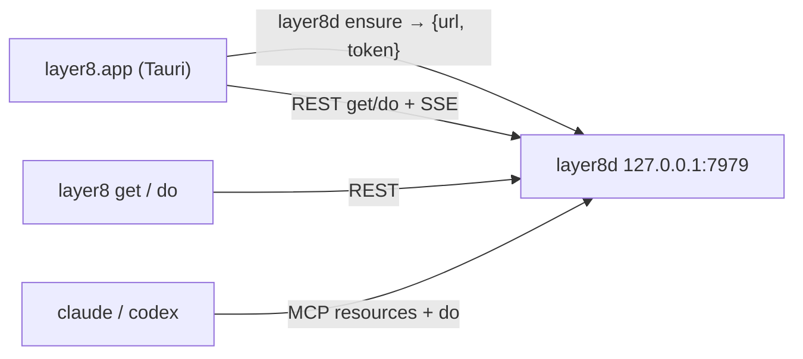

# layer8

A single-user macOS desktop app for agent work: projects → tasks → sub-tasks → sessions. A Go daemon (`layer8d`) owns all state; the Tauri window, the `layer8` CLI and agents (over MCP) are clients of one node tree.



## The node tree

Everything is a node with an address (`app`, `project:api-gateway`, `task:eng-482/pr2`, `here`). Reading a node returns its fields, children and the actions valid right now with a JSON Schema for their args. Every action is recorded in `actions_log` with who triggered it.

| Door | Read | Act |
|---|---|---|
| HTTP | `GET /api/node?addr=app&depth=1` | `POST /api/do` `{"ops":[{"target","action","args"}]}` |
| MCP `POST /mcp` | `resources/read layer8://project/api-gateway` | tool `do` |
| CLI | `layer8 get project:api-gateway [--json]` | `layer8 do app add-project path=/src/api-gateway` |
| Live | `GET /api/events` (SSE: `node`, `session`, `ui`, `toast`) | |

## Layout

| Path | Role |
|---|---|
| `cmd/layer8d` | `serve`, `ensure`, and the CLI (`get`, `do`); `bin/layer8` is a symlink |
| `internal/tree` | kinds, actions, `Get`/`Do`, `Render`, args validation |
| `internal/server` | loopback/origin/token guard, HTTP API, SSE hub |
| `internal/mcp` | MCP streamable HTTP endpoint |
| `internal/projects` | `app` and `project` kinds |
| `internal/linear` | Linear GraphQL client, API key / OAuth PKCE, `linear` kind |
| `internal/store` | SQLite + migrations |
| `internal/config` | `~/.layer8` (or `LAYER8_HOME`), `config.json`, token |
| `internal/daemon` | wiring, serve, launchd agent `dev.layer8.daemon` |

## Linear

`linear` lists your open issues as `linear:<ID>` children; `linear:ENG-482` reads one issue (with a `markdown` rendering), and `layer8 do linear search query=upload` searches. Credentials live in `~/.layer8/linear.json` (0600).

- **API key (default):** create one in Linear → Settings → Security & access → Personal API keys, then `layer8 do linear connect apiKey=lin_api_…`.
- **Sign in with Linear (optional):** create your own OAuth app in Linear → Settings → API → OAuth applications with callback URL `http://127.0.0.1:7979/api/linear/callback`, put its client id in `~/.layer8/config.json` as `"linearClientId"`, restart the daemon, then `layer8 do linear connect-oauth` and open the returned URL. PKCE is used, so no client secret is stored.

Tasks link to issues, they don't mirror them. A linked task's `linear` field is `{id, url, title, state}`; its state is re-read from Linear at most once a minute when the task is read.

| Action | On | Does |
|---|---|---|
| `create-task-from-linear {issue}` | project | task titled like the issue, branch = Linear's branch name, `01-ticket.md` in the artifacts, linked |
| `link-linear {issue}` / `refresh-linear` / `unlink-linear` | task | set, re-read or clear the link; root tasks (re)write `01-ticket.md` |
| `create-subtask {…, linear: true}` | task | also creates a Linear sub-issue under the task's issue and links the sub-task to it |
| `open-pr` | linked task | also attaches the pull request to the issue; a Linear failure is reported in the message, the PR still opens |

## Develop

```sh
make test     # go test ./...
make daemon   # bin/layer8d + bin/layer8
make dev      # run the daemon from source with LAYER8_HOME=./.dev-home
```

The UI runs in a browser against `make dev`: `cd app && npm i && npm run dev`, then open `http://localhost:5173/?url=http://127.0.0.1:7979&token=$(cat .dev-home/token)`. Without a reachable daemon it falls back to an in-memory mock. `npm run tauri dev` opens it in the Tauri window.
