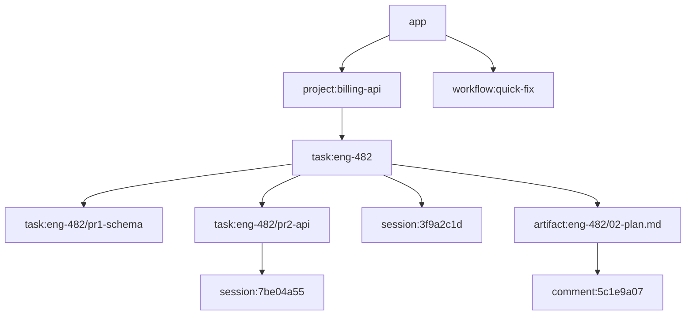

# Concepts

Everything in layer8 is a **node** in one tree: the app holds projects, projects hold tasks, tasks hold sub-tasks and sessions. Each task has its own branch and worktree, and a whole task tree shares one artifacts folder. Every node lists the actions you can take on it right now, and the window, the CLI and the agents all act through those same actions.

## The node tree

| Address | Node | Example actions |
|---|---|---|
| `app` | the app: projects and workflows | `add-project` |
| `project:<name>` | a git repository | `create-task`, `rename`, `remove` |
| `task:<slug>` / `task:<slug>/` | a task or sub-task | `start-session`, `create-subtask`, `run-workflow`, `commit`, `push`, `open-pr`, `set-link`, `done`, `archive` |
| `session:<id8>` | one agent conversation | `say`, `send-now`, `allow`, `deny`, `interrupt`, `fork`, `close` |
| `artifact:<task>/<file>` | a file in the artifacts folder | `write`, `delete`, `add-comment` |
| `comment:<id8>` | a comment to the agent | `resolve`, `reopen`, `edit`, `delete` |
| `here` | from inside a session: the session's own task | everything the task offers |

Read any node with `layer8 get <address>`; the output ends with the actions valid now. See [CLI](cli.md).

## Projects

A project is a local git repository you added with **Add project** (`add-project path=…`). layer8 records its path and default branch, and never changes your own checkout. Removing a project from layer8 leaves the repository on disk.

## Tasks and sub-tasks

A task is one piece of work. Creating one (`create-task title=…`) makes:

| What | Default | Override with |
|---|---|---|
| a slug, used in the address and folders | derived from the title, e.g. `fix-invoice-rounding` | `slug` |
| a branch | the slug | `branch` |
| a base branch | the project's default branch | `base` |
| a worktree | `~/.layer8/worktrees/<project>/<slug>/` | — |
| an artifacts folder | `~/.layer8/tasks/<slug>/` | — |

A **sub-task** (`create-subtask name=…`, ⌘⇧N) is a child task whose branch is stacked on its parent's branch, or on a sibling's with `base=<sibling>`. Big work splits into one sub-task per pull request: `pr1-schema`, then `pr2-api` on top of it. Each sub-task gets its own worktree, `~/.layer8/worktrees/<project>/<slug>--/`, and its PR targets the branch it is stacked on.

A task is `active`, `done` (worktree kept) or `archived` (worktrees of the task and its sub-tasks removed, branches and artifacts kept). `reopen` brings it back.

## Artifacts

Every task tree, the root task and all its sub-tasks, shares **one artifacts folder**, `~/.layer8/tasks/<root-slug>/`. Skills write their output there as numbered Markdown files: `01-ticket.md`, `02-research-billing.md`, `03-plan-billing.md`, `pr-description.md`. A session in any sub-task can read what the research session wrote in the root. Agents find the folder in `$LAYER8_ARTIFACTS`.

The **Artifacts** panel lists and renders them; you can edit, delete and comment on them.

## Sessions

A session is one conversation with an agent, started in the task's worktree (`start-session`, ⌘T).

| Field | Values |
|---|---|
| harness | `claude` (Claude Code) or `codex` |
| skill | optional: a skill or slash command to run first, e.g. `layer8:implement` |
| model, effort, permission mode | passed to the harness; change them with `set` |
| status | `queued`, `starting`, `running`, `waiting`, `idle`, `done`, `failed` |

Talk to it with `say` (the Session panel's input). A message sent while the agent is busy queues until the turn ends; `send-now` (**Send now**) delivers it at once. `interrupt` stops the current turn, `fork` copies the conversation into a new session, `open-terminal` continues it in your terminal, `close` ends it. At most `maxSessions` (default 6) run at once; the rest queue.

Every session gets the layer8 MCP server, so the agent can read `layer8://here` (its task, branch, base, worktree and artifacts) and apply actions with the `do` tool, for example to create sub-tasks or open the PR.

## Approvals

When an agent wants to run a tool its permission mode doesn't allow, the session goes to `waiting` and shows **Allow**, **Always** and **Deny** (keys A and D). Only you can answer, never an agent. By default the agent's own layer8 `do` calls need approval too; set `autoApproveDo: true` in [`config.json`](configuration.md) to let them through.

## Diff, commit, push, pull request

| Action | Does | Needs GitHub |
|---|---|---|
| (Changes panel) | the task's diff against its base branch | no |
| `commit message=…` | commits the worktree's changes, or only `paths` | no |
| `push` | pushes the branch, replacing it only if it hasn't moved since | no, your git credentials |
| `open-pr` | pushes and opens the PR against the task's base, or links the one already open. Body defaults to `pr-description.md` | yes |
| `refresh-pr` | reads the PR's state, checks and review threads now | yes |

## Comments

You can comment on a passage of an artifact or a line of the diff (`add-comment`). Comments collect as `open`; **Send N comments to …** (`send-comments`) delivers all of them to a session in one message and marks them `sent`. The agent fixes what each points at and calls `resolve` with a one-line reply. The `review-comments` skill does this for a whole batch.

## Workflows

A workflow is a named list of skills that run one after another as sessions on a task. See [Workflows & skills](workflows.md).

[← Getting started](getting-started.md) · [Workflows & skills →](workflows.md)
