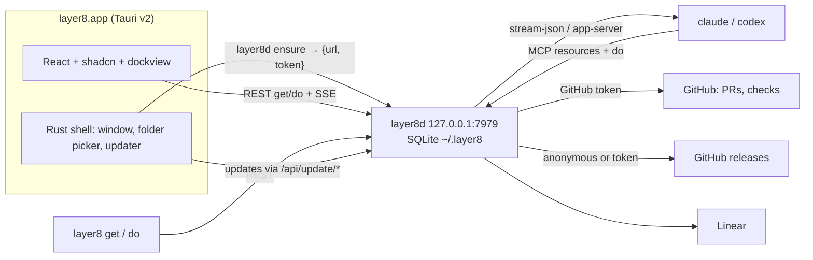
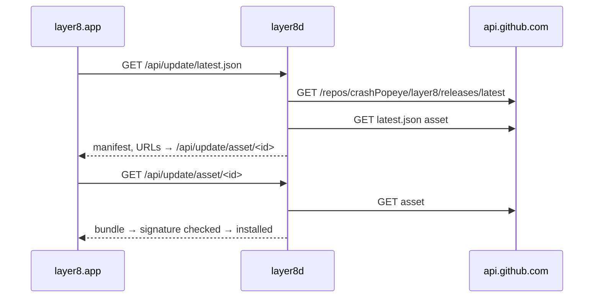

# Contributing

layer8 is a Go daemon (`layer8d`) plus a Tauri v2 window (React, shadcn, dockview) and a Claude Code plugin of skills. You can run the daemon and the UI from source with `make dev` and `npm run dev`; macOS builds and releases are made locally with `make app` and `make release`. Pull requests are welcome; CI must pass before merge.

## Architecture

The daemon owns all state and every agent process, and outlives the window as the launchd agent `dev.layer8.daemon`. The window, the `layer8` CLI, agents (over MCP) and UI plugins are all clients of one node tree.



## The node tree

Everything is a node with an address (`app`, `project:api-gateway`, `task:eng-482/pr2`, `here`). Reading a node returns its fields, children and the actions valid right now, with a JSON Schema for their args. Every action is recorded in `actions_log` with who triggered it (`user`, `cli`, or a session).

| Door | Read | Act |
|---|---|---|
| HTTP | `GET /api/node?addr=app&depth=1` | `POST /api/do` `{"ops":[{"target","action","args"}]}` |
| MCP `POST /mcp` | `resources/read layer8://project/api-gateway` | tool `do` |
| CLI | `layer8 get project:api-gateway [--json]` | `layer8 do app add-project path=/src/api-gateway` |
| Live | `GET /api/events` (SSE: `node`, `session`, `ui`, `toast`) | |

A package adds a kind with `tree.Register`, or extends another package's kind with `Extend` (actions), `AddFields` and `AddChildren`. That's how `diff`, `github`, `workflows` and `comments` all add actions to `task` without `tasks` knowing about them.

## Repo layout

| Path | Role |
|---|---|
| `cmd/layer8d` | `serve`, `ensure`, and the CLI (`get`, `do`); `bin/layer8` is a symlink |
| `internal/tree` | kinds, actions, `Get`/`Do`, `Render`, args validation |
| `internal/tasks`, `internal/gitx` | tasks and sub-tasks, worktrees, branches, artifacts |
| `internal/sessions`, `internal/harness/{claude,codex}` | sessions, approvals, transcripts, capability probe |
| `internal/workflows`, `plugin/` | workflows and the bundled layer8 Claude Code plugin (skills) |
| `internal/diff`, `internal/github`, `internal/comments` | diff, commit, push, pull requests and their status, comments to the agent |
| `internal/update` | the app's update feed, served from the latest GitHub release of `updateRepo` |
| `internal/server` | loopback/origin/token guard, HTTP API, SSE hub |
| `internal/mcp` | MCP streamable HTTP endpoint |
| `internal/projects` | `app` and `project` kinds |
| `internal/linear` | Linear GraphQL client, API key / OAuth PKCE, `linear` kind |
| `internal/store` | SQLite + migrations |
| `internal/config` | `~/.layer8` (or `LAYER8_HOME`), `config.json`, token |
| `internal/ui` | `ui:layout`, `ui:theme`, `ui:plugins`: dock layout and presets, themes, JS plugins |
| `internal/daemon` | wiring, serve, launchd agent `dev.layer8.daemon`, restart onto a new binary when idle |
| `app/` | the Tauri window: `src/` React UI and panels, `src-tauri/` Rust shell |
| `e2e/` | the cut-over check against a real daemon and the real `claude` |
| `docs/` | this site, served by GitHub Pages from `main:/docs` |

## Develop

You need Go 1.26, Node 22, and for app builds Rust (installed through `rustup` by `make app` if missing).

```sh
make test     # go test ./...
make daemon   # bin/layer8d + bin/layer8
make dev      # run the daemon from source with LAYER8_HOME=./.dev-home
```

The UI runs in a browser against `make dev`:

```sh
cd app && npm i && npm run dev
open "http://localhost:5173/?url=http://127.0.0.1:7979&token=$(cat ../.dev-home/token)"
```

Without a reachable daemon it falls back to an in-memory mock. `npm run tauri dev` opens it in the Tauri window. App checks: `npm run typecheck && npm test` in `app/`.

To work on the skills, point `pluginDir` in `.dev-home/config.json` at the repo's `plugin/` folder so sessions load your edits.

CI runs on pull requests, on Linux: `gofmt`, `go vet`, `go test`, the app typecheck and tests. Everything macOS is built locally.

## Build and release

| Command | Does |
|---|---|
| `make app` | universal `layer8.app`, DMG and signed updater bundle in `app/src-tauri/target/universal-apple-darwin/release/bundle/`. Installs Rust targets if needed; ad-hoc signs unless `APPLE_SIGNING_IDENTITY` is set; Tauri notarises when `APPLE_ID`/`APPLE_PASSWORD`/`APPLE_TEAM_ID` (or `APPLE_API_*`) are set |
| `make release VERSION=x.y.z` | `make app` at that version, writes `latest.json`, and publishes the GitHub release `vx.y.z` with `gh release create`. Needs a clean tree pushed to origin |
| `make e2e` | the cut-over check: a temp repo, a real daemon on a free port, real `claude` (haiku), the `quick-fix` workflow on autopilot, `open-pr` against a fake GitHub and a local bare remote. About 40 s and a few cents |

The updater signing key lives in `~/.layer8-release/updater.key` (generated on first build, never committed); its public key is `plugins.updater.pubkey` in `app/src-tauri/tauri.conf.json`. Losing the key means installed apps can't verify new updates.

### How updates flow

The app checks `http://127.0.0.1:7979/api/update/latest.json` with its daemon token. The daemon reads the latest release of `updateRepo` (default `crashPopeye/layer8`), anonymously or with the GitHub token when there is one, rewrites the asset URLs in its `latest.json` to `/api/update/asset/<id>`, and streams only those assets. After an update, the new app's `layer8d ensure` asks the old daemon to restart, which it does once no session is running.



[← CLI](cli.md) · [Overview](index.md)
