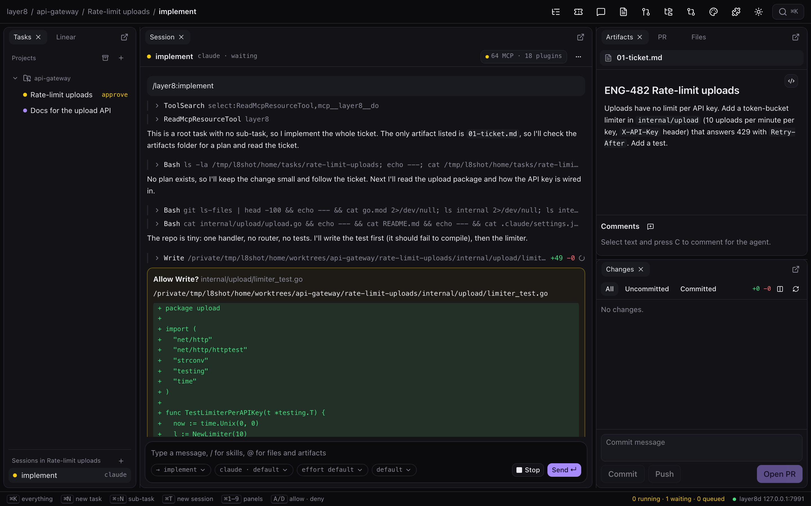
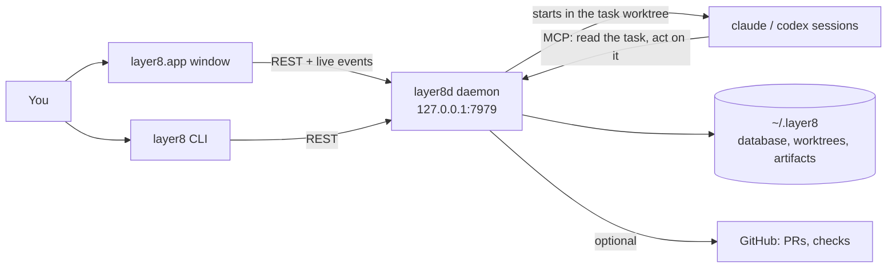

# layer8

layer8 is a macOS desktop app for running coding agents (Claude Code and Codex) on real work. You add a git repository as a project, create a task for each piece of work, and every task gets its own branch and worktree. Agents run as sessions inside the task, write their notes to a folder the whole task shares, and take the work from research to a reviewed diff and an open pull request. A background daemon keeps the sessions running when the window is closed.

## Who it's for

Developers who already use `claude` or `codex` in a terminal and want to run several pieces of work side by side without juggling branches, terminals and notes by hand. It's single-user and runs on your Mac: nothing leaves your machine except what the agents and `git push` send, and the GitHub calls listed in [Install](install.md#what-needs-github).

## A day with layer8

| Step | You do | You see |
|---|---|---|
| 1 | Add `~/code/billing-api` as a project | `billing-api` in the Tasks panel |
| 2 | Create the task `fix-invoice-rounding` | a branch `fix-invoice-rounding` and a worktree under `~/.layer8/worktrees/billing-api/` |
| 3 | Run the `quick-fix` workflow | a Claude session starts in the worktree and implements the fix |
| 4 | Review the diff, comment on a line, send the comment | the agent revises and commits |
| 5 | Click **Next** | the agent writes the PR description and opens PR #42 |
| 6 | Watch the PR panel | checks and review threads, refreshed in place |

[Getting started](getting-started.md) walks through it step by step.

## How it fits together

The daemon `layer8d` owns all state and every agent process. The window, the CLI and the agents themselves are clients of the same tree of nodes (app → project → task → session), so an agent can create sub-tasks, start sessions or open a PR the same way you do. See [Concepts](concepts.md).

## Docs

| Page | Answers |
|---|---|
| [Install](install.md) | Prerequisites, the DMG, Gatekeeper, the CLI, what needs GitHub, updates, uninstall |
| [Getting started](getting-started.md) | First project → task → workflow → diff → pull request |
| [Concepts](concepts.md) | The node tree, projects, tasks and sub-tasks, worktrees, artifacts, sessions, approvals, comments |
| [Workflows & skills](workflows.md) | The built-in workflows, the skills, autopilot, writing your own workflow |
| [Panels & customisation](panels.md) | The panels, layouts, themes, plugins, ⌘K, links to issues |
| [Configuration](configuration.md) | Every setting with its default, and the `~/.layer8` layout |
| [CLI](cli.md) | `layer8 get` and `layer8 do` |
| [Contributing](contributing.md) | Architecture, repo layout, building from source, releasing |

layer8 is open source under the [Apache-2.0 license](https://github.com/crashPopeye/layer8/blob/main/LICENSE).

[Install →](install.md)
