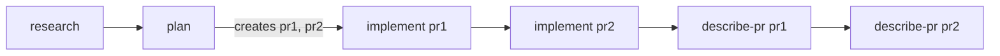

# Workflows & skills

A **skill** is a set of instructions an agent follows for one kind of job: research the code, write a plan, implement it, open the PR. A **workflow** chains skills: each step starts a fresh session on the task with one skill, and the next step starts when the previous one calls `advance`. layer8 ships 4 workflows and 13 skills, and you can write your own workflows in YAML.

## Built-in workflows

| Workflow | Steps | Use it for |
|---|---|---|
| `quick-fix` | implement → describe-pr | Implement a small change and open its pull request |
| `feature` | research → plan → implement\* → describe-pr\* | Research, plan the work into stacked sub-tasks, implement each one and open its pull request |
| `product-feature` | research → prd → tdd → plan → implement\* → describe-pr\* | Research, write the PRD and the technical design, plan, implement and open the pull requests |
| `pr-care` | fix-ci → address-comments | Get an open pull request green, then answer its review comments |

\* runs once per sub-task (`fanout: subtasks`). The `plan` step creates one stacked sub-task per pull request; the fanned-out step then starts a session in each, in stack order: `pr2` starts after `pr1` is done. With no sub-tasks it runs on the task itself.



## Skills

Skills are named `layer8:<skill>`. They come with the app, are reinstalled into `~/.layer8/plugin` at every daemon start, and are also installed for Codex as `layer8-<skill>`. You can run any of them on its own: start a session with the skill, or type `/layer8:<skill>` in a session.

| Skill | What it does |
|---|---|
| `research-questions` | Turn a task into the factual questions a researcher must answer about the codebase before anyone designs a solution. Writes `NN-research-questions-<slug>.md` |
| `research` | Document how the code relevant to a task works today, with file:line references, without proposing changes. Writes `NN-research-<slug>.md` |
| `prd` | Write a product requirements document from the ticket and the research: the problem, who has it, what success looks like, and the solution at the level of behaviour. Writes `NN-prd-<slug>.md` |
| `tdd` | Write the technical design: architecture, contracts, data model and the decisions behind them. Writes `NN-tdd-<slug>.md` |
| `plan` | Turn the research and design into an implementation plan split into reviewable pull requests, and create one stacked sub-task per PR when there are several. Writes `NN-plan-<slug>.md` |
| `implement` | Implement the plan for the current task or sub-task in its worktree, verify it with the project's tests, and commit |
| `review` | Review the task's changes against its base branch and the plan, correctness first, then scope, tests and simplicity. Writes `NN-review-<slug>.md` |
| `describe-pr` | Write the pull request description from the diff and artifacts, then open the PR (stacked on the parent's branch for sub-tasks) |
| `fix-ci` | Make the pull request's checks pass: read the failing jobs, reproduce locally, fix, push, repeat |
| `address-comments` | Work through the unresolved review comments on the pull request: change the code where the reviewer is right, answer where they aren't, then push and reply |
| `review-comments` | Address the comments you left in layer8 on artifacts and diff lines, then mark each one resolved |
| `make-panel` | Build a custom panel from a plain-language request ("a panel listing my open PRs across projects") as a JS plugin in `~/.layer8/plugins` |
| `layer8` | How to read and drive layer8 from a session: find the task, its artifacts, create sub-tasks, start sessions, open panels |

## Autopilot or step by step

Pick a workflow from the **Workflow…** menu in the task header.

| Mode | How | After each step |
|---|---|---|
| step by step (default) | Autopilot ▶ off | the header shows **Next: &lt;step&gt; ▸**: read the artifacts, comment, then click it |
| autopilot | Autopilot ▶ on | the next step starts as soon as the previous one finishes |

`stop-workflow` ends the workflow; its sessions keep running. The actions behind the buttons:

| Action | On | Does |
|---|---|---|
| `run-workflow workflow=<name> [autopilot:=true]` | task | starts the first step |
| `next-step` | task | starts the next step when the workflow is waiting |
| `advance [step=<name>]` | task | marks the current step finished; skills call it when their work is done |
| `stop-workflow` | task | stops the workflow |

```sh
layer8 do task:fix-invoice-rounding run-workflow workflow=quick-fix
layer8 do task:fix-invoice-rounding next-step
```

## Write your own workflow

Put a YAML file in `~/.layer8/workflows/`. The file name is the workflow name (lowercase letters, digits and dashes). A file named like a built-in, e.g. `quick-fix.yaml`, replaces it. Run `layer8 do app reload-workflows`, or restart the daemon, to pick up changes.

```yaml
# ~/.layer8/workflows/reviewed-fix.yaml
description: Implement a small change, review it with Codex, then open the PR
steps:
  - name: implement
    skill: layer8:implement
  - name: review
    skill: layer8:review
    harness: codex
  - name: describe-pr
    skill: layer8:describe-pr
    model: haiku
```

| Field | Required | Values |
|---|---|---|
| `description` | no | shown in the app |
| `steps[].name` | yes | unique in the workflow, lowercase letters, digits and dashes |
| `steps[].skill` | yes | any skill or slash command, e.g. `layer8:plan` or one of your own |
| `steps[].harness` | no | `claude` (default) or `codex` |
| `steps[].model` | no | passed to the harness, e.g. `opus`, `haiku` |
| `steps[].effort` | no | passed to the harness |
| `steps[].fanout` | no | `subtasks`: run the step once per active sub-task, in stack order |

A file that doesn't parse shows as `invalid` under `layer8 get app`, and `layer8 get workflow:<name>` prints the error.

A step's skill must call `advance` when its work is done, or the workflow waits; the layer8 skills all do. Your own skills can end with the same call:

```json
{"ops":[{"target":"here","action":"advance"}]}
```

[← Concepts](concepts.md) · [Panels & customisation →](panels.md)
