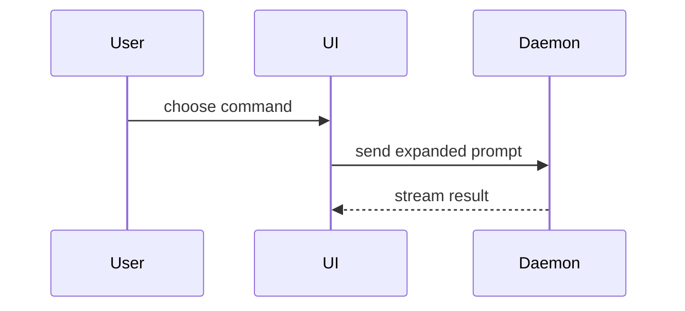

Help the user understand the current topic of conversation visually. Skip the preamble and keep prose brief. Pick the smallest view that makes the key point clear.

- Show logic or an algorithm as pseudocode:

```text
on(save)
  if content is unchanged
    return cached result
  write new content
  return fresh result
```

- Show runtime control flow as a call tree:

```text
submitForm
  createSession
    persistPrompt
    launchAgent
  navigateToSession
```

- Show UI structure as a component tree, including state and module boundaries that matter:

```tsx
<SessionPage> (apps/example/src/routes/session.tsx)
  useSessionEvents()
  <SessionToolbar>
    <RunSkillButton> (packages/ui)
```

- Show file responsibility or a broad refactor as a shallow file tree:

```text
src/
├── commands/       # parses user actions
├── sessions/       # owns session state
└── transport/      # sends API requests
```

- Show component interaction, control flow, or data flow with Mermaid. layer8 renders ```` ```mermaid ```` fences in its palette:



- Use `diff` when the point is what changes and the surrounding shape already exists. Match the diff shape to the topic.

For a component change:

```diff
 <SessionPage>
   useSessionEvents()
   <SessionToolbar>
+    <RunSkillButton />
   <SessionTimeline>
+    <SkillResultCard />
```

For a file-layout change:

```diff
 src/
 ├── commands/
+│   └── show-me.ts       # expands the slash command
 ├── sessions/
-└── transport.ts
+└── transport/
+    ├── client.ts
+    └── stream.ts
```

For a state or control-flow change:

```diff
 on(save)
-  write content
+  if content is unchanged
+    return cached result
+  write new content
+  invalidate cache
```

- Show the whole block when most of it is new, when omitted context would hide ownership or order, or when the user needs a copyable target shape.

## HTML artifacts

For a visual UI, a layout, a state comparison, or a concept too dense for Mermaid, create one focused HTML artifact:

1. Write a single self-contained file to `.layer8/task/show-me-<description>.html` with the Write tool. It appears in the Artifacts panel at once.
2. Display it inline in your reply, with its path relative to `.layer8/task/`:

````markdown
```task-artifact
show-me-<description>.html
```
````

How layer8 runs it:

- It renders in an iframe sandboxed with `allow-scripts allow-popups allow-popups-to-escape-sandbox` and never `allow-same-origin`. Scripts run, but the page has an opaque origin: no cookies, no `localStorage`, and no access to the layer8 API.
- Inline your CSS and JS. Scripts from a CDN (`cdn.jsdelivr.net`, `unpkg.com`, `cdnjs.cloudflare.com`) load. Images and other files next to the HTML in `.layer8/task/` load with relative URLs.
- Match the app: square corners, 1px borders, the system sans font with IBM Plex Mono for code, and the rose-pine palette:

```css
:root { --bg:#191724; --bg-alt:#1f1d2e; --fg:#e0def4; --dim:#908caa; --accent:#c4a7e7;
        --accent-alt:#ebbcba; --border:#6e6a86; --ok:#9ccfd8; --warn:#f6c177; --err:#eb6f92; }
```

- Use real labels and data from the task, not placeholders. Support a narrow panel (about 400 px) as well as a full window.

Place each visual next to the short text it supports. Keep only the calls, files, props, states, and boundaries needed to answer the user's current question.
